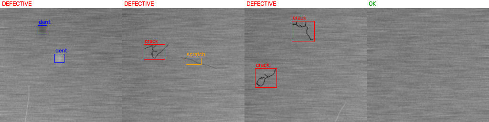

# Industrial Computer Vision for Defect Inspection

An OpenCV-based workflow for automated visual inspection: it finds surface defects on
manufactured parts, classifies them (scratch, crack, dent) and marks each part as
`OK` or `DEFECTIVE`, from image acquisition to defect identification.

> **Important: the images are simulated.** No real production images are used.
> `src/generate_dataset.py` creates 256x256 grayscale images of brushed-metal surfaces
> (texture, uneven lighting, sensor noise) with randomly placed scratches, cracks and dents.
> The goal of this repository is to show the inspection workflow, not to claim results on
> a real production line. Real images will be harder (reflections, varied materials, rare
> defects), so expect lower scores there.

## Approach

1. **Flat-field correction**: the image is smoothed and a large-scale Gaussian background
   is subtracted to remove uneven lighting.
2. **Anomaly map**: pixel deviations are converted to robust z-scores (median / MAD) and
   thresholded; morphological closing and connected components give candidate regions.
3. **Features per region**: area, bounding-box size, extent, aspect ratio, solidity,
   compactness, contrast statistics and polarity (dark or bright).
4. **Classification**: a Random Forest assigns each region to `scratch`, `crack`, `dent`
   or `none` (false alarm). A part is `DEFECTIVE` if at least one region is not `none`.
5. **Evaluation on unseen images**: train and test sets are generated with different
   random seeds (500 training images, 200 test images).

## Results (200 simulated test images)

| Metric | Value |
|---|---|
| Image-level accuracy | 0.975 |
| Image-level precision (defective) | 1.000 |
| Image-level recall (defective) | 0.964 |
| Image-level F1 | 0.982 |
| False alarms on good parts | 0 |
| Missed defective parts | 5 |
| Defect localisation recall (labelled defects found) | 0.934 |

Per-class results for the candidate regions are in `results/confusion_matrix.png`;
all numbers are in `results/metrics.json`. Faint defects are the main source of misses.



## Usage

```bash
python -m venv .venv && source .venv/bin/activate    # Windows: .venv\Scripts\activate
pip install -r requirements.txt

python src/generate_dataset.py                       # creates data/train and data/test (simulated)
python src/train.py                                  # trains the classifier, writes results/
python src/inspect_image.py data/test/images/img_0001.png     # inspect one image
python src/inspect_image.py data/test/images --out results/inspected   # inspect a folder
```

Run all commands from the project root. Results are reproducible (fixed seeds).

## Project structure

```
src/generate_dataset.py   simulated surface images and defect labels
src/inspector.py          OpenCV candidate detection, features, annotation
src/train.py              classifier training and evaluation
src/inspect_image.py      command-line inspection of images
results/                  metrics, confusion matrix, example detections
```

## Limitations and next steps

- Validate on real inspection images (for example a public surface-defect dataset).
- Replace the Random Forest with a convolutional neural network for harder defect types.
- Add a camera interface and a PASS/FAIL signal for a PLC or sorting station.

## License

MIT
